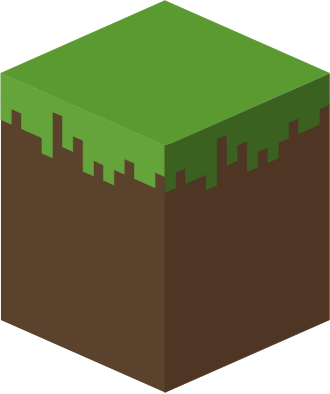

<h1>NativeVoxel</h1>

<h3>Minecraft 1.8.9, running natively in C++.</h3>

  
  
  
  
  

A familiar world of blocks, with a native client underneath. Built one system at a time, with the feel of 1.8.9 in mind.

  <a href="https://github.com/TinypxNetwork/NativeVoxel/releases"><b>Download preview</b></a>
  &nbsp;·&nbsp;
  <a href="#build-from-source">Build from source</a>
  &nbsp;·&nbsp;
  <a href="https://github.com/TinypxNetwork/NativeVoxel/issues">Report an issue</a>
  &nbsp;·&nbsp;
  <a href="README.zh-CN.md">简体中文</a>

If you'd like to see where this goes, give the project a ⭐ Star.

---

## A native take on 1.8.9

NativeVoxel is a C++17 client for Windows, using OpenGL 3.3 and Minecraft's original protocol 47. It can explore local worlds, build, use inventories and containers, and connect to servers. The game runs without a JVM.

This is an early preview. There's plenty to try, but singleplayer is not yet a complete survival game, and multiplayer compatibility still depends on the server.

| Part | What's there |
| :--- | :--- |
| **Worlds & building** | Overworld, Nether and End terrain, Anvil loading, movement and collision, crafting, storage, furnaces and brewing. |
| **Rendering** | Chunk meshes, lighting and ambient occlusion, animated textures, first- and third-person views, entities, equipment and particles. |
| **Multiplayer** | Protocol 47, encrypted login, compression, world and inventory updates, chat and containers. |
| **The familiar details** | Resource pack reloads, configurable controls, Unicode fonts, formatted chat, item tooltips, positional sound and music. |

Mob spawning and AI, redstone, fluid updates, portals, complete world decoration and the remaining survival interactions are still in progress. Some rendering details differ from vanilla.

The latest source adds container inventory drops on destruction, standard Anvil item/XP entity interchange, and sign editing in local worlds and multiplayer. See the [1.8.9 parity audit](PARITY.md) for references, remaining gaps and reproducible tests. These changes are in source; the v0.1.0 preview download predates them.

## Start playing

1. Download the **Windows x64 ZIP** from [Releases](https://github.com/TinypxNetwork/NativeVoxel/releases) and extract the whole archive.
2. For first-time setup, install **Python 3.10+** and run:
   `python -m pip install "Pillow>=10" "numpy>=1.24"`
3. Double-click **`run.cmd`** inside the extracted package.

The launcher downloads about **118 MiB** of original resources from Mojang, checks their hashes and sizes, and converts them before starting the game. Completed downloads are cached, so you can rerun setup if the connection drops.

After setup, the game needs neither Python nor Java. Keep the supplied DLLs and `assets/` beside the executable. You'll need an **OpenGL 3.3 capable GPU**.

<b>Controls and launch options</b>

| Keys | Action |
| :--- | :--- |
| WASD · Space · Shift · Ctrl | Move · Jump · Sneak · Sprint |
| E · T · Q | Inventory · Chat · Drop an item |
| Number keys / mouse wheel | Select a hotbar slot |
| F5 · F2 · F3 · F11 | Perspective · Screenshot · Debug info · Fullscreen |

Mouse buttons interact with the world. Controls and sound settings can be changed in Options.

~~~powershell
# Generate a local world. Creative mode is the default.
.\NativeVoxel.exe --vanilla --seed 189

# Open an existing Anvil world.
.\NativeVoxel.exe --world "D:\Worlds\MyWorld"

# Connect to a server.
.\NativeVoxel.exe --connect mc.tinypx.net --username YourName

# Try the rendering and physics demo.
.\NativeVoxel.exe --demo
~~~

Online-mode servers require a valid Minecraft session. The client reads `MC_ACCESS_TOKEN` and `MC_UUID` from the local process environment and uses the matching player name. It does not include a Microsoft sign-in screen. Server-side registration and login are handled by the server.

**A note on saves:** NativeVoxel writes a new snapshot under `saves/` and leaves imported worlds unchanged. Snapshots include loaded chunks, not the entire imported world. Dropped items and XP orbs are imported and exported through standard Anvil entities. Other entity types are not fully simulated, and internal simulation state still uses `native_simulation.dat`, so save interchange is not yet complete.

## Build from source

The repository contains the C++ client and the third-party source it needs. Compilation requires **MinGW-w64 with C++17, zlib and OpenSSL**. It does not require Python, Java, MCP or game assets. The current build has been verified with GCC 8.3.

<b>Toolchain setup and the full build command</b>

[MSYS2](https://www.msys2.org/) provides the compiler and libraries. In its **UCRT64** terminal:

~~~sh
pacman -S --needed mingw-w64-ucrt-x86_64-gcc mingw-w64-ucrt-x86_64-zlib mingw-w64-ucrt-x86_64-openssl
~~~

Open PowerShell with the compiler on `PATH`. For a default MSYS2 installation, add `C:\msys64\ucrt64\bin` to that session's `PATH`.

~~~powershell
git clone https://github.com/TinypxNetwork/NativeVoxel.git
cd NativeVoxel

$sources = (Get-ChildItem src -Filter *.cpp).FullName
g++ -std=c++17 -O3 -DNDEBUG -ffp-contract=off -fno-fast-math `
    -DNOMINMAX -DWIN32_LEAN_AND_MEAN -D_WIN32_WINNT=0x0601 -I include $sources `
    -o NativeVoxel.exe -lopengl32 -lgdi32 -luser32 -lshell32 -lwinmm `
    -lws2_32 -lwinhttp -ldnsapi -lcrypto -lz -lole32 -lwindowscodecs -luuid `
    -lstdc++fs -static-libgcc -static-libstdc++

.\NativeVoxel.exe --help
~~~

Keep the floating-point flags shown above: changing them can affect movement and world generation.

| Directory | Contents |
| :--- | :--- |
| `src/` | Client implementation |
| `include/mc/` | Headers and compiled-in data tables |
| `third_party/` | Vorbis decoder, provenance and license notices |
| `tests/` | Self-contained protocol, simulation, save and sign editor regressions |

To play with your own build, prepare the release package once, then put your EXE in that folder with its DLLs and `assets/`. Alternatively, keep the runtime DLL directory on `PATH` and pass `--assets D:/NativeVoxel/assets` to use the prepared resources.

Resource packs can be selected in game and should target 1.8.9 (`pack_format: 1`).

Run `powershell -ExecutionPolicy Bypass -File tests/run.ps1` to rebuild and run the five regression groups. They use generated fixtures and need no game assets, Java or MCP. Each run writes its results to a separate `build/parity-*` directory.

## License

NativeVoxel's original code is licensed under **[GNU GPL v3](LICENSE)** (`GPL-3.0-only`).

Third-party components and images retain their own terms; see [third-party notices](THIRD_PARTY_NOTICES.md). Minecraft and its original resources belong to Mojang/Microsoft and their respective authors. NativeVoxel is an independent project, not an official Minecraft product.

---

<h3><a href="https://ai.tinypx.top">TinyPx API</a></h3>

<b>AI API relay for your apps and side projects.</b> If you're building something with AI, take a look.

<a href="https://ai.tinypx.top"><b>Visit ai.tinypx.top ↗</b></a>

Advertisement

